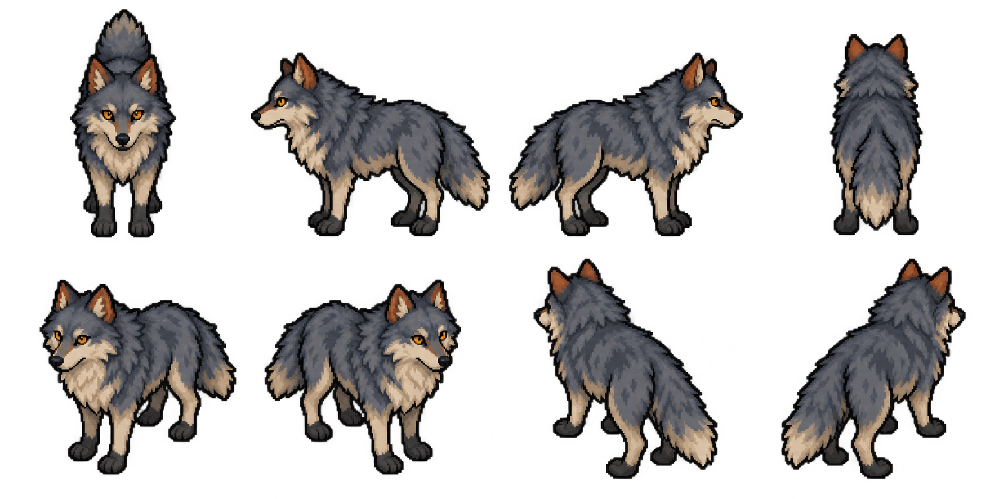

# Curadoria individual em andamento

O inventário anterior não constitui aprovação artística. Todas as referências
começam pendentes, incluindo aliases: a referência animada precisa de revisão
própria mesmo quando partilha a primeira imagem de outra.

`node tools/references/progress.mjs` percorre a cobertura completa e apresenta
as pendências. Um argumento pesquisa o caminho original ou ID:
`node tools/references/progress.mjs '/Wolf.gif'`.

## Primeiro rascunho: lobo

Origem exata e hash do rascunho estão em `../curadoria.json`. Não está no
runtime nem no build publicado. As oito vistas foram inspecionadas como estudo
de anatomia; isso não aprova animação, escala, alinhamento ou integração.
Uma tentativa inicial de 160 quadros foi rejeitada por espaçamento irregular.

Para concluir uma criatura, faltam os ciclos completos nas oito direções,
âncora estável, transições sem saltos, recorte sem perda, corpo de colisão,
comparação com a referência e teste em uma cena real. A folha de vistas
isolada não atende a esses requisitos.

Objetos compostos precisam de remontagem identificada; efeitos precisam de
trajetórias, áreas e término; pisos precisam de conexões e bordas. A revisão
precisa contemplar cada referência original e todos os seus quadros relevantes,
não só os nomes, a primeira imagem ou a aparência de um modelo compartilhado.

Não há adaptações individuais completas aprovadas neste checkpoint.
